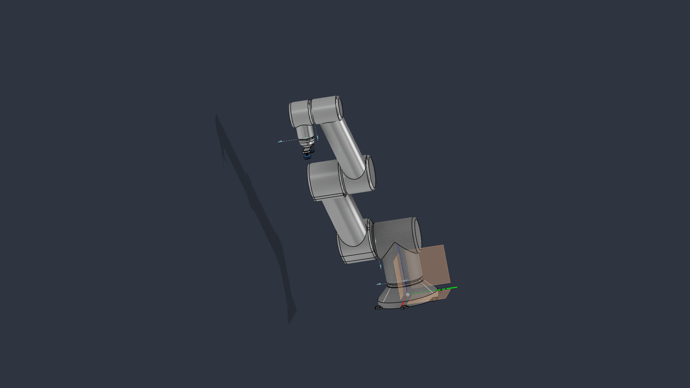

# chocolate_robot — Robot Description



## Overview

| Property | Value |
|----------|-------|
| Total mass | 164.592 kg |
| Links | 6 |
| Joints | 5 (5 movable) |
| Assemblies | 1 |
| Root link | `base_link` |

## Table of Contents

- [Kinematic Tree](#kinematic-tree)
- [Link Properties](#link-properties)
- [Joint Properties](#joint-properties)
- [Assembly Breakdown](#assembly-breakdown)
- [Quick Start (ROS 2)](#quick-start-ros-2)
- [Files](#files)

## Kinematic Tree

```
base_link
  └─ joint_1 [continuous]
    link_1 [BAKE]
      └─ joint_2 [continuous]
        link_2 [BAKE]
          └─ joint_3 [continuous]
            link_3 [BAKE]
              └─ joint_4 [continuous]
                link_4 [BAKE]
                  └─ joint_5 [continuous]
                    link_5_suctioncup [BAKE]
```

## Link Properties

| Link | Mass (kg) | Material | Collision | Bodies |
|------|-----------|----------|-----------|--------|
| `base_link` | 34.0877 | Stainless_Steel_Brushed | cylinder | 1 |
| `link_1` | 59.1884 | Stainless_Steel_Brushed | box | 1 |
| `link_2` | 40.8937 | Aluminum | box | 1 |
| `link_3` | 26.2337 | Aluminum | box | 1 |
| `link_4` | 3.6275 | Aluminum | box | 1 |
| `link_5_suctioncup` | 0.5607 | Aluminum | box | 1 |

## Joint Properties

| Joint | Type | Parent → Child | Axis | Limits |
|-------|------|---------------|------|--------|
| `joint_1` | continuous | `base_link` → `link_1` | (0,0,1) | — |
| `joint_2` | continuous | `link_1` → `link_2` | (0,0,1) | — |
| `joint_3` | continuous | `link_2` → `link_3` | (0,0,1) | — |
| `joint_4` | continuous | `link_3` → `link_4` | (0,0,1) | — |
| `joint_5` | continuous | `link_4` → `link_5_suctioncup` | (0,0,1) | — |

## Assembly Breakdown

### chocolate_robot

- **Links**: link_4, link_3, link_2, link_1, base_link, link_5_suctioncup
- **Total mass**: 164.592 kg

## Quick Start (ROS 2)

```bash
# 1. Copy package to your ROS 2 workspace
cp -r chocolate_robot_description ~/ros2_ws/src/

# 2. Build
cd ~/ros2_ws
colcon build --packages-select chocolate_robot_description
source install/setup.bash

# 3. Visualize in RViz2
ros2 launch chocolate_robot_description display.launch.py

# 4. Validate URDF structure
check_urdf install/chocolate_robot_description/share/chocolate_robot_description/urdf/chocolate_robot.urdf

# 5. Print kinematic tree
urdf_to_graphviz install/chocolate_robot_description/share/chocolate_robot_description/urdf/chocolate_robot.urdf
```

**Joint control**: The launch file includes `joint_state_publisher_gui` —
use the sliders to move revolute/prismatic joints in RViz2.

**Topic inspection**:
```bash
# See published joint states
ros2 topic echo /joint_states

# See robot description parameter
ros2 param get /robot_state_publisher robot_description
```

## Files

| Path | Description |
|------|-------------|
| `urdf/chocolate_robot.urdf.xacro` | Top-level xacro (entry point) |
| `urdf/chocolate_robot.urdf` | Flat URDF (for validation) |
| `urdf/assemblies/` | Per-assembly xacro macros |
| `meshes/` | Visual (OBJ) and collision (STL) meshes |
| `launch/display.launch.py` | Launch robot_state_publisher, RViz, and generated controllers |
| `config/joint_state.yaml` | Joint state publisher config |
| `config/ros2_controllers.yaml` | Generated ros2_control controller manager config |
| `robot_data.yaml` | Supplementary data (beyond URDF) |
| `docs/transforms.md` | Transformation matrices (KaTeX) |

## Customizing

Assemblies tagged `!dummy_` are designed to be swapped out. To replace one:

1. Create your replacement as a xacro macro with the same interface
2. Place it in `urdf/assemblies/`
3. Update the `<xacro:include>` in `urdf/chocolate_robot.urdf.xacro`
4. Update meshes in `meshes/<your_assembly>/`

The xacro prefix system (`${prefix}`) ensures link names stay unique
when multiple instances of the same assembly are used.

---
*Generated by Fusion URDF/XACRO Exporter v3.1.1*